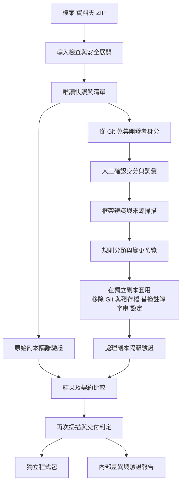

# 程式碼去識別系統架構與驗證設計

採用與框架無關的處理核心，搭配語言解析器、框架 adapter 與隔離驗證 runner。介面僅提供本機 CLI（已確認不做 Web UI），須在 Windows、macOS、Linux 上執行。處理範圍限於註解、字串、設定檔、Git 資訊與殘存檔，不做識別字重命名。

## 1 處理流程



預覽階段不執行來源程式。變更計畫綁定輸入雜湊與政策版本；套用前再次檢查，來源變動即中止並重新掃描。套用採暫存輸出加原子完成標記，禁止失敗後留下外觀上完整的交付包。

## 2 模組責任

| 模組 | 責任 |
| --- | --- |
| Ingestor | 驗證輸入、限制解壓、建立快照和檔案清單 |
| Identity harvester | 在移除 `.git` 前，安全讀取 commit author／committer、remote URL、refs，產生開發者身分候選清單（見第 2.1 節） |
| Residue cleaner | 依殘存檔清單移除 IDE、OS、log、快取、建置產物，記錄每個被移除的路徑 |
| Detector | 依檔案與設定辨識語言、框架、子專案及相依關係 |
| Scanner | 掃描 Git、來源詞彙、註解、文件、設定及機密候選 |
| Policy engine | 整合預設、專案詞彙、保留規則、風險分類與人工決策 |
| Transformer | 依語法位置產生最小編輯，維持語法有效性 |
| Framework adapter | 框架保護規則、驗證計畫、契約擷取與比較 |
| Validation runner | 在隔離環境安裝、建置、啟動及測試，限制資源與網路 |
| Reporter | 差異、結果、殘留與內部稽核資料；HTML 輸出須跳脫來源文字 |
| Packager | 根據明確清單建立 ZIP，排除內部報告、機密與工作暫存 |

語言 parser 處理語法；framework adapter 處理語意。例如 Python 註解處理可供 FastAPI 與其他 Python 框架共用，不把所有規則綁在 FastAPI。

### 2.1 開發者身分蒐集與 Git 安全

對不可信的 repository 直接執行 `git` 指令有風險：`.git/config` 可設定 `core.fsmonitor`、`core.sshCommand` 等在執行時觸發任意程式。因此：

- 以純 Python 的 Git 實作（如 dulwich）**直接讀取物件與 refs**，不呼叫 `git` 執行檔、不執行 hook、不讀取全域設定。
- 蒐集內容：所有 commit 的 author／committer 姓名與信箱、`remote.*.url` 中的 host／organization／repository、分支與 tag 名稱中的帳號片段、`.mailmap`、CODEOWNERS 中的 `@帳號`。
- 推導變體：信箱 local-part、`名.姓`／`姓名` 組合、GitHub noreply 信箱中的帳號、大小寫變化。
- 同時蒐集組織資訊候選：作者信箱網域、remote host（含 GitHub Enterprise 主機）、organization 與 repository 名稱。
- 產生 `identities.yaml`（內部檔案）：列出每個真實身分及其變體，全部對應到單一 `developer`；組織詞彙對應到 `company`、`*.example.internal`、`org/repo`、`systemNN`。使用者可刪除誤判或補充詞彙後才進入掃描。
- 交付包不含任何 Git 中繼資料，也不產生新的 repository。

## 3 建議技術與選擇理由

這裡是實作提案，版本須於開發時固定並以 fixture 驗證，不承諾任意 Python、Angular 或 TypeScript 版本皆受支援。

- **Python 核心與 CLI**：負責工作生命週期、檔案、規則與報告；資料結構可使用 Pydantic，CLI 可選 Typer 或標準 argparse。
- **註解與字串定位**：因為已確認不做重命名，只需精準找出「註解」與「字串常數」的位置，建議統一使用 **tree-sitter**（Python、TypeScript、HTML、CSS/SCSS 皆有 grammar，且提供 Windows／macOS／Linux 預編譯 wheel，不必另起 Node worker）。找到位置後只在該範圍內做文字替換，不重新列印整檔，換行與格式自然保留。
- **擴充語言**：新框架只要加入對應 tree-sitter grammar 與 adapter（如 Java、C#、Go）。若日後需要語意層級修改，再於個別 adapter 內改用 LibCST、TypeScript compiler API 等工具，不影響核心。
- **HTML、CSS、SCSS、JSON 與 JSONC**：各用符合語法的解析策略；不支援的語法只回報，不以正則表示式代替 parser。
- **報告與儲存**：使用工作目錄及 JSON／HTML，不需資料庫。
- **結構化設定檔**：JSON／JSONC、YAML（`ruamel.yaml` 保留註解）、TOML（`tomlkit`）、INI、XML 以格式感知方式只改命中的值。
- **機密偵測**：`detect-secrets` 規則加自訂正則，全程離線。
- **跨平台**：一律用 `pathlib`；讀寫時以原始位元組判斷並保留編碼、BOM 與 LF／CRLF；外部指令以 argv 呼叫，Windows 上用 `shutil.which` 解析 `npm.cmd`／`npx.cmd`；長路徑與大小寫碰撞在 Ingestor 檢查。

TypeScript 的 `removeComments` 是編譯輸出設定，不能單獨滿足來源檔案去識別與逐項比對需求。[TypeScript 官方文件](https://www.typescriptlang.org/tsconfig/removeComments.html)

## 4 Adapter 契約

建議每個 adapter 實作以下介面；這是設計契約，尚非現有 API。

```text
detect(manifest) -> DetectionResult
capabilities(project) -> CapabilitySet
protected_regions(project) -> ProtectedRegion[]
plan_transforms(project, findings, policy) -> Edit[]
validation_plan(project, profile) -> ValidationStep[]
capture_contract(project, runner) -> ContractSnapshot
compare_contract(before, after, allowed_changes) -> Comparison
```

adapter 宣告支援副檔名、框架／runtime 版本範圍、必要工具與保證的驗證層級。`capture_contract` 可能需要載入應用，因此只能在 runner 內執行。未知框架可用通用 metadata 掃描與已支援語言規則，但不得繼承「框架驗證通過」。

多專案 repository 依子專案分派 adapter，最後加跑跨專案 smoke test。子專案有任一必要驗證失敗，整體即不得合格。

## 5 FastAPI 保護與驗證

保護 Python import、decorator、路由、dependency injection、Pydantic alias、環境設定、動態載入與序列化名稱。首版不做識別字重命名。

docstring 並非單純註解；FastAPI 可將其中內容帶入 OpenAPI 文件，因此移除須是明確接受的文件變更，並比較處理前後 OpenAPI。[FastAPI 官方文件](https://fastapi.tiangolo.com/advanced/path-operation-advanced-configuration/)

驗證包括解析、相依重建、既有測試、測試設定下的 import／啟動、設定的健康端點、代表性 API 和資料庫流程。不得假設一定有 `/health` 或固定 ASGI app 路徑，須由專案 profile 提供或辨識後確認。

OpenAPI 比較預設保護 method、path、參數、required、schema、response、security 與 operationId。允許修改的 description 等欄位使用精確 JSON path 白名單；不能把所有文字欄位差異都忽略。關閉 OpenAPI 的專案改用明確契約測試，無替代證據則標示不完整。

## 6 Angular 保護與驗證

保護 decorator、selector、template binding、DI token、路由、i18n ID、asset 路徑、environment 與跨檔 import。模板和樣式須使用對應解析策略，不能只處理 `.ts`。

從 `angular.json` 辨識 project、build target 及環境設定；Angular workspace 可以為不同專案設定不同 builder，不能假設所有專案只有一條固定 build 指令。[Angular 官方文件](https://angular.dev/reference/configs/workspace-config)

使用專案既有 lockfile 與對應套件管理器，執行指定正式建置設定、現有測試、瀏覽器開頁及登入／主要路由／API 串接 smoke test。記錄 console error、HTTP 失敗與關鍵 DOM 斷言；僅 build 成功不算 L3 通過。測試依專案實際 runner，不強制沿用特定測試框架。

產出的 bundle、source map 和靜態資產可能含來源線索；交付 build 時須再掃描實際產物。無法分析的資產明列未處理；不能只清來源卻宣稱產物也完成去識別。

## 7 不可信輸入與隔離執行

輸入檢查拒絕 ZIP 路徑穿越、絕對路徑、重複正規化名稱、大小寫碰撞、符號連結和特殊檔案；按實際串流解壓量限制總大小、單檔大小、檔案數與壓縮比例。首版不遞迴展開巢狀壓縮檔、不處理加密 ZIP。資料夾輸入不跟隨 symlink，避免讀出來源根目錄外的資料。

套件安裝、build script、import、測試與啟動都可能執行來源中的任意程式。不得在服務主程序或使用者主機工作目錄直接執行；驗證優先使用短生命週期的受限 container（Docker／Podman，Windows 與 macOS 透過 Docker Desktop 或 Podman Desktop）：非 root、唯讀輸入、獨立可寫暫存、無宿主機憑證及 Docker socket，限制 CPU、記憶體、程序數和時間。無 container 時可退回本機子程序模式，但在報告中標示「未隔離執行」。

依賴取得與執行分階段控制網路：必要下載只允許內部 npm／pip mirror（已確認可連線，私有套件原樣安裝）；runtime 預設只能存取同一隔離測試網路中的 stub、資料庫與前後端。私有 registry 需要短效、最小權限的存取方式，不能把憑證烘進映像或報告。無法取得依賴就標記不完整。

submodule 和 Git LFS 未展開時，不自動連線補齊；要求準備實際內容，否則指出缺漏。若程式或 build 依賴 `git describe`，移除 `.git` 後須明確提供替代版本值並驗證，不能靜默改寫。

## 8 工作資料與狀態

核心資料物件：

- `Job`：ID、輸入快照雜湊、policy hash、工具版本、adapter 版本、狀態、產物位置。
- `Finding`：規則、路徑、範圍、語法情境、類別、風險、遮罩摘要、處置及原因。
- `Edit`：目標檔雜湊、修改範圍、動作、替代內容及對應 finding；原始內容留在受控快照。
- `ValidationResult`：baseline／sanitized、步驟、runtime、環境識別、exit code、pass／fail／skip／error、日誌位置。
- `Artifact`：類型、內容雜湊、受限／可交付、產生時間、是否完成包裝。

狀態為 `received → scanned → planned → transformed → validating → completed`；任何階段可進入 `failed` 或 `cancelled`。`completed` 只表示工作結束，另以 `delivery_status` 表達 `qualified`、`incomplete`、`regression` 或 `blocked`，避免工作完成被誤讀成可交付。

去識別殘留狀態與執行驗證狀態分開記錄。只有無阻擋的去識別結果加上所有必要驗證通過，才是 `qualified`。

## 9 規則設定草案

以下僅示意未來設定內容，不是目前可執行的檔案格式。

```yaml
schema_version: 1
profile: conservative
terms:
  - value: Example Internal Project
    match: exact
    contexts: [ordinary_comment]
    action: redact
preserve:
  license_notices: true
  tool_directives: true
transform:
  remove_git_metadata: true
  rename_symbols: false          # 已確認不重命名
  targets: [comments, strings, config, docs]
  docstrings: identity_only      # 只替換身分資訊
identity:
  harvest_from_git: true
  pseudonym: developer           # 所有開發者統一替換
organization:
  terms:
    - {value: Acme, category: company}
    - {value: corp.acme.com, category: domain}
    - {value: PAYGW, category: system}
  extra_patterns:
    employee_id: 'E\d{6}'
residue:
  remove_defaults: true
  keep: []                       # 例：保留去識別後的 .vscode/settings.json
allowlist:
  private_packages: ['@acme/*']  # 私有套件原樣保留
  registries: ['npm.internal.example']
secrets:
  action: replace_and_flag
validation:
  required_levels: [L0, L1, L2]   # L3 視專案是否提供啟動方式
  project_profile: local-test-profile
export:
  include_diff_in_source_zip: false
  block_on_unresolved_secrets: true
```

規則檔與測試 profile 可能含原始識別詞，屬內部資料。測試指令須以 argv 與受控工作目錄描述，不把使用者字串拼成 shell 指令；即使如此仍必須在隔離 runner 執行。
